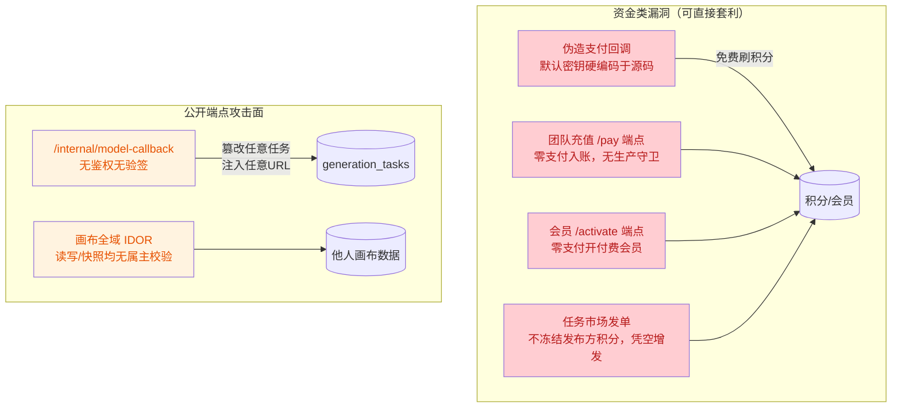
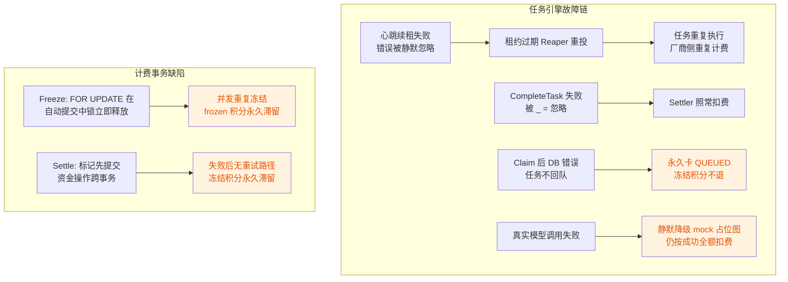

# 后端全面代码审查报告（整合版）

> **审查日期**: 2026-08-20
> **审查对象**: `duanju-backend`（S1~S5 全量代码，含 cmd / internal / migrations）
> **审查方式**: 4 个专项审查（认证安全 / 计费支付 / 任务引擎 / 业务数据层）+ 2 个独立验证代理交叉确认 + **25 个问题逐项人工代码复验**
> **验证结论**: 25 个关键问题**全部复现确认、零误报**（逐项验证记录见 H 章）
> **总体结论**: 架构清晰、密码学选型正确、无 SQL 注入，但存在**多处可直接套利的资金类漏洞**与**任务引擎可靠性缺陷**，当前状态不可上生产
> **整合说明**: 本报告整合原《01 - 后端全面审查报告》与《02 - 后端全面审查报告（复审）》，为唯一有效版本

---

## A. 审查概览

### A.1 问题统计

| 严重度 | 数量 | 说明 |
|--------|------|------|
| 🔴 Critical | 5 | 可直接套利的资金类漏洞，上线前必须修复 |
| 🟠 Major | 13 | 高严重度安全/可靠性缺陷，本迭代修复 |
| 🟡 Minor | 7 | 已交叉验证的功能性缺陷 |
| ⚪ 加固项 | 20+ | 首轮发现、未二次验证，滚动排期 |

### A.2 风险总览





---

## B. Critical 问题（5 个，上线前必须修复）

### 1. 支付验签永远走 mock HMAC，"生产强制关闭 mock"是死配置

- **位置**: `internal/engine/billing/alipay.go:221-247`（verifySignature）、`internal/router/router.go:227-233`
- **描述**: `AlipayConfig.UseMock`/`PublicKey`/`CallbackURL` 三个字段在整个 billing 包中从未被读取。`verifySignature` 无条件走 mock HMAC 路径，生产环境与开发环境验签行为完全相同。且 `MockSecret` 默认值 `dev-alipay-mock-secret` 硬编码在源码中，任何人可据此对 `POST /orders/:order_no/pay-callback` 构造合法签名的伪造回调，将任意 PENDING 订单置为 PAID 并获得积分/会员——零成本刷积分。router.go:227 的注释"生产环境强制关闭 mock 支付（P0 修复）"计算出的 `useMock` 从未被消费。
- **证据**:
  ```go
  // alipay.go:242 —— 永远使用 MockSecret，无任何 UseMock/RSA2 分支
  mac := hmac.New(sha256.New, []byte(s.cfg.MockSecret))
  ```
- **复验**: ✅ alipay.go:221-247 确认无 UseMock/RSA2 分支
- **建议**: 实现 RSA2 验签分支并真正消费 `UseMock`；密钥不得有源码默认值，生产环境缺失 `ALIPAY_MOCK_SECRET` 时拒绝启动。

### 2. 团队充值零支付入账端点无生产守卫

- **位置**: `internal/domain/space/service.go:339-357`（TeamRechargeCallback）、`internal/repository/space_billing.go:146-184`（PaySpaceOrder）、路由 `space/handler.go:42`
- **描述**: `POST /spaces/billing/orders/:order_no/pay`（v1Auth 组，仅 JWT）直接将订单置 PAID 并给 SPACE 账户加积分。整个链路唯一的校验是"请求者 == 订单创建者"——而订单正是攻击者自己创建的。攻击路径：`TeamRecharge` 下单 → 调用该端点 → 免费获得积分。注释自称"开发期端点"，但没有任何 `Env != "production"` 运行时拦截。
- **复验**: ✅ service.go:339-357 确认无任何环境守卫，PaySpaceOrder（space_billing.go:160-184）仅做归属校验后入账
- **建议**: 加生产环境运行时守卫，或接入真实支付回调后彻底移除。

### 3. 会员激活零支付端点无生产守卫

- **位置**: `internal/repository/membership_store.go:68-120`（Activate）、路由 `internal/domain/creation/handler.go:116`
- **描述**: `POST /memberships/orders/:order_no/activate`（仅 JWT）→ 锁定订单 → 归属校验 → 直接 `UPDATE orders SET pay_status='PAID'` → 旧会员置 EXPIRED → 新建 ACTIVE 会员。与问题 2 同构，零支付开通 PRO/ENTERPRISE/ULTIMATE 会员。
- **复验**: ✅ membership_store.go:67-118 确认仅归属校验即置 PAID 并建 ACTIVE 会员，无环境守卫
- **建议**: 同问题 2。

### 4. 厂商回调无鉴权无验签，可篡改任意任务状态并注入任意 URL

- **位置**: `internal/domain/creation/canvas_extra_service.go:201-234`（ModelCallback）、`internal/router/router.go:173-176`
- **描述**: 五重缺陷：
  1. 无签名验证：`signature_valid` 硬编码 `TRUE`，migration 000009 的防重放设计被完全架空；
  2. 任意伪造任务成功：`UPDATE ... SET status='SUCCESS' ... WHERE id=$1` 无状态守卫（不限 RUNNING）、无归属校验，知道 `external_task_id` 即可把任意任务置为成功并注入任意 `result_url`（存储型钓鱼内容下发给用户）；
  3. 失败回调路径完全失效：`status='FAILED'` 不是合法枚举值（枚举定义为 `FAILED_RETRYING/FAILED_DEAD`），UPDATE 必然报错且被 `_, _ =` 吞掉；
  4. 审计日志必然写入失败：`provider_id` 写死 `0`，违反外键约束（BIGSERIAL 从 1 起），INSERT 必然失败且错误被忽略——回调日志表实际永远为空；
  5. `:provider` 路由参数接收后从未使用，无任何来源校验。
- **复验**: ✅ canvas_extra_service.go:201-234 五重缺陷逐一确认（:220 硬编码 TRUE、:225-227 无守卫、:228-231 非法枚举+吞错、:221 provider_id=0）
- **建议**: 增加签名校验（利用现成的 `signature_valid` 字段与唯一索引设计）；UPDATE 加 `WHERE status='RUNNING'` 守卫；修掉 `provider_id=0` 与非法枚举两处硬 bug。

### 5. 任务市场积分凭空增发

- **位置**: `internal/repository/market_store.go:191-205`（CreateOrder）、`272-292`（UpdateOrderStatus COMPLETED 分支）
- **描述**: 发单时（CreateOrder）只插入 `task_orders` 行，既不冻结也不扣除发布方 `reward_points`（service 层 `Reward` 仅 `min=0` 无上限、无余额校验）；验收完成时直接给接单人 `current_balance+$2` CREDIT，全程没有对应的发布方 DEBIT。积分凭空增发——双账号协作（A 发单 reward=21 亿 → 同伙 B 接单 → A 验收）即可无限刷积分。
- **验证补充**: 并发双 COMPLETED 会被 `point_transactions.idempotency_key`（`task-reward-{oid}`）UNIQUE 约束拦截，"并发双发"不成立；但"凭空增发"核心成立。
- **复验**: ✅ market_store.go:191-205 确认 CreateOrder 仅 INSERT 订单行，无任何冻结/扣减
- **建议**: 发单时冻结发布方积分，COMPLETED 结算改为"发布方 DEBIT + 接单人 CREDIT"对称事务。

---

## C. Major 问题（13 个，本迭代修复）

### 6. 画布全域 IDOR：读写/快照均无属主校验

- **位置**: `internal/repository/canvas_store.go:73-190`（ResolveCanvas/SaveCanvas/LoadCanvas/SaveNodes/ListSnapshots/RestoreSnapshot）、`internal/domain/creation/canvas_service.go:65-162`
- **描述**: 画布的读、写、节点替换、快照查看/恢复全链路 SQL 的 WHERE 只有 `canvas_uuid`/`version`，没有 `created_by`。任何登录用户拿到他人 canvas_uuid 即可读取全部画布内容、通过乐观锁覆写、替换全部节点、恢复任意历史快照。对比同文件 `ListCanvases`（按 `created_by=$1` 过滤）属系统性遗漏。缓解：canvas_uuid 为随机 UUID，盲扫难度大。
- **复验**: ✅ canvas_store.go:75、86、102 确认 WHERE 仅 canvas_uuid，无 created_by
- **建议**: SQL 加属主条件（或 space 成员校验），Service 层传入 uid。

### 7. 未配置可信代理，ClientIP 可被 X-Forwarded-For 伪造——三道防线全部失效

- **位置**: `internal/router/router.go:37`（全仓唯一 `gin.New()`，无 `SetTrustedProxies`）
- **受影响**: ① 限流绕过（`rate_limit.go:24` 键含 ClientIP，伪造 XFF 每个键都达不到阈值）；② 登录爆破锁定绕过（`auth/service.go:64` 失败计数键含 ClientIP，可无限次尝试密码）；③ Token 指纹绑定失效（`middleware/auth.go:88-89` 指纹 = ClientIP+UA，被盗 Token 者伪造受害者 IP+UA 即可通过比对）。
- **复验**: ✅ router.go:37 确认 `gin.New()` 后无 SetTrustedProxies 调用
- **建议**: `r.SetTrustedProxies([]*net.IPNet{...})` 仅信任 LB/网关地址，或直连部署时 `r.SetTrustedProxies(nil)`。

### 8. Refresh Token 不轮换、旧 Token 不吊销

- **位置**: `internal/domain/auth/service.go:108-149`
- **描述**: `Refresh` 校验旧 refresh token 后签发全新 token 对，但从未将旧 refresh token 的 jti 写入黑名单（黑名单只在 Logout 中写入）。旧 refresh token 7 天内始终可用，无轮换即无重用检测；结合问题 7（指纹可伪造），被盗 refresh Cookie 是最长 7 天的持久访问凭据。
- **复验**: ✅ service.go:107-148 确认 Refresh 仅读取黑名单（:120），全程无写入旧 jti
- **建议**: 刷新成功后将旧 refresh jti 以剩余 TTL 写入黑名单，并实现重用检测。

### 9. 封禁（BANNED）用户已持有 Token 不失效

- **位置**: `internal/domain/space/repo.go:138-145`（GetUserIDByUUID）、`internal/middleware/load_user.go`
- **描述**: SQL 仅 `WHERE user_uuid=$1 AND deleted_at IS NULL`，不过滤 status。管理员封禁用户后，其已签发 access token（TTL 2h）在全部 v1Auth 接口（含扣积分下单）继续有效。Login/Refresh 有 BANNED 检查，但每请求执行的 LoadUserID 反而没有。
- **复验**: ✅ repo.go:140 确认 SQL 无 status 过滤
- **建议**: 查询加 `AND status='ACTIVE'`（或至少 `AND status<>'BANNED'`）。

### 10. 三阶段冻结非原子：FOR UPDATE 锁形同虚设

- **位置**: `internal/engine/billing/engine.go:83-108`（Freeze）、`internal/repository/billing_store.go:27-37、93-111`
- **描述**: `LoadTaskBill`（幂等检查）、`GetAccountForUpdate`（余额检查）、`SaveTaskBill`、`store.Freeze`（真正事务）是四条独立自动提交语句 + 一个独立事务。`FOR UPDATE` 跑在 pool 上，语句结束锁即释放。并发重复冻结同一任务时：双双通过幂等检查（TOCTOU），余额 UPDATE 执行两次，而流水 INSERT 因 `ON CONFLICT (idempotency_key) DO NOTHING` 静默跳过——唯一键保护反而被 DO NOTHING 放行。frozen_balance 膨胀一份，结算只解冻一份，差额永久滞留。缓解：`CHECK(current_balance>=0)` 拦截超额负余额。
- **复验**: ✅ engine.go:87-106 确认四步分别为独立自动提交调用
- **建议**: 四步收拢到单事务，余额 UPDATE 加守卫条件。

### 11. Settle 结算标记与资金操作跨事务，失败后无恢复路径

- **位置**: `internal/engine/billing/engine.go:136-158`
- **描述**: `MarkTaskSettled`（自动提交）先提交，然后 `Deduct`/`Unfreeze` 才在各自新事务执行。若后者失败，任务已标记 settled，重试被 `ErrAlreadySettled` 挡回——冻结积分既不扣也不退，永久滞留。另 `actualCost < cost` 时只扣实际成本，差额部分没有任何解冻调用。
- **复验**: ✅ engine.go:135-157 确认 MarkTaskSettled 先于 Deduct/Unfreeze 提交
- **建议**: `MarkTaskSettled` 改为事务内 CAS（`UPDATE ... WHERE is_success_refunded=FALSE`），与资金变动同事务。

### 12. 支付回调未校验 trade_status

- **位置**: `internal/engine/billing/alipay.go:174-213`（HandleCallback）
- **描述**: 验签 7 步中从未读取 `trade_status`。支付宝会为 `WAIT_BUYER_PAY`、`TRADE_CLOSED` 等状态重复推送；按本实现，只要签名有效且金额匹配，任何状态的通知都会执行"订单置 PAID + 加积分"。`BuildMockCallback` 也未包含该字段，测试无法暴露此缺陷。
- **复验**: ✅ alipay.go:174-213 确认全流程无 trade_status 读取
- **建议**: 仅 `trade_status=TRADE_SUCCESS` 时入账。

### 13. 任务重复执行：CompleteTask 错误忽略 + 心跳续租失败静默忽略

- **位置**: `internal/engine/task/worker.go:144-171`
- **描述**: `_ = w.store.CompleteTask(...)` 错误被忽略后 Settler(true) 无条件执行；心跳两处续租错误均被 `_ =` 忽略。租约过期 → Reaper 回收重投 → 第二个 Worker 重复执行（厂商 API 重复计费）→ 原 Worker 完成时 CompleteTask 因 lease_owner 不匹配失败（被忽略），Settler 照常执行。积分不会双扣（MarkTaskSettled CAS 幂等），但厂商侧重复调用真实存在。
- **复验**: ✅ worker.go:145、167-168 三处 `_ =` 忽略确认
- **建议**: CompleteTask 失败时跳过 Settler；续租失败累计阈值后主动取消执行。

### 14. Redis Claim 后 DB 错误：任务永久卡 QUEUED，冻结积分不退

- **位置**: `internal/engine/task/worker.go:79-93`
- **描述**: `queue.Claim` 的 Lua 已将任务 ZREM 出队；随后 `ClaimForRun` 返回 DB 错误时仅 `Release` 锁，任务不回 Redis 队列，DB 状态停留 QUEUED，Outbox 已 PUBLISHED。恢复机制全部不覆盖：ReapExpired 只扫 RUNNING、RequeueDue 只扫 FAILED_RETRYING、Dispatcher 只处理 PENDING/PROCESSING 的 Outbox。migration 000009 预留了 `idx_gen_tasks_queued_repair` 索引但代码从未实现对应扫描。
- **复验**: ✅ worker.go:84-88 确认 DB 错误仅 Release 锁不回队
- **建议**: 补 QUEUED 超时修复扫描（利用已预留索引）。

### 15. ReapExpired 无 max_retry 上限，任务永不进死信

- **位置**: `internal/repository/task_store.go:234-243`
- **描述**: 回收重投的 UPDATE 仅 `retry_count = retry_count + 1`，无上限判定、不转 FAILED_DEAD（对比 FailTask 有完整死信判定）。反复导致租约过期的任务被无限重投，叠加问题 10/11 冻结积分长期滞留。
- **复验**: ✅ task_store.go:234-243 确认仅 retry_count+1，无死信判定
- **建议**: 补 max_retry 判定与死信路径，对齐 FailTask 行为。

### 16. 真实模型调用失败静默降级 mock，任务仍按成功全额扣费

- **位置**: `internal/engine/agent/asset_handler.go:90-107`、`video_handler.go:94-113`
- **描述**: 真实生成失败（含 RetryableError）仅打日志后降级为 mock 占位 URL（`mock_cdn.go` 默认 `http://localhost:5174`，无环境守卫，生产同样生效），随后正常入库、Execute 返回成功，worker 走成功路径结算扣费。用户被扣真实积分拿到占位图/样例视频。
- **复验**: ✅ asset_handler.go:98-105 确认失败仅打日志后拼接 mockCDNBase 占位 URL 并正常入库
- **建议**: 生产环境任务置失败并退款，禁用降级。

### 17. 轮询遇 429/5xx 立即放弃，触发任务级重试致厂商重复计费

- **位置**: `internal/engine/model/async_provider.go:181-198`
- **描述**: 仅网络错误才等待重试；查询接口返回瞬时 429/5xx 时直接 `return NewRetryableError` 放弃整个异步任务 → worker FailTask 重试 → `createTask` 重新创建厂商任务（旧任务仍在厂商侧运行并计费）。轮询阶段本应等待重试。
- **复验**: ✅ async_provider.go:193-195 确认 429/5xx 直接 return RetryableError
- **建议**: 429/5xx 等待 pollInterval 后继续轮询。

### 18. Webhook secret 明文入库 + 按 URL 全局验签混淆

- **位置**: `internal/repository/openapi_store.go:77-93`
- **描述**: ① `secret` 明文 INSERT（对比 API Key 是 sha256 哈希存储），数据库泄露即泄露所有回调签名密钥；② `VerifyWebhook` 仅按 `WHERE url=$1` 查询不限定 user_id，两个用户注册相同 URL 时 `ORDER BY id DESC LIMIT 1` 会用别人的 secret 验签，跨用户验签混淆。
- **复验**: ✅ openapi_store.go:79-81 明文 INSERT、:87-88 仅按 url 查询均确认
- **建议**: secret 加密存储（项目已有 cryptox）；查询加 user_id 维度。

---

## D. Minor 问题（7 个，已交叉验证 + 人工复验）

### 19. 订单过期机制完全未实现

- **位置**: `migrations/000010_billing.up.sql:109、122`
- **描述**: `expired_at` 列与部分索引齐备，但全仓 Go 代码无任何消费，无 PENDING→EXPIRED 流转任务。PENDING 订单永久堆积；过期回调入账依赖问题 1/2/3 伪造路径才可达（真实支付宝不为未支付订单推送成功回调）。
- **复验**: ✅ 全仓 grep 确认 Go 代码中 expired_at 仅出现于枚举定义（enums_gen.go），无任何流转实现
- **建议**: 补定时任务将过期 PENDING 订单置 EXPIRED，回调路径加过期校验。

### 20. 会员到期判断字符串格式比较错误，到期日当天提前降级

- **位置**: `internal/repository/membership_store.go:31、41-44`
- **描述**: `current_period_end::text`（PG 格式，空格分隔）与 RFC3339（T 分隔）做字符串比较，第 11 字符 `' '(0x20) < 'T'(0x54)`，到期日当天 00:00 起即判定过期——付费会员提前最多近 24h 降级 BASIC，且触发一次写库。
- **复验**: ✅ membership_store.go:40 确认 `endAt < time.Now().UTC().Format(time.RFC3339)` 字符串比较
- **建议**: 改为 `time.Time` 比较（DB 侧直接 `current_period_end < NOW()` 判断）。

### 21. 置 PAID 不检查 RowsAffected

- **位置**: `internal/repository/space_billing.go:163-169`、`membership_store.go:88-94`
- **描述**: `UPDATE orders SET pay_status='PAID' WHERE pay_status='PENDING'` 影响 0 行时错误未被检查，代码继续入账。当前无退款流属潜伏缺陷（对比 order_store.go PayCallback 的正确实现）。
- **复验**: ✅ space_billing.go:166-169、membership_store.go:90-93 确认均无 RowsAffected 检查
- **建议**: 补 `tag.RowsAffected() != 1` 检查。

### 22. WS Hub 向已关闭 channel 发送竞态可 panic（潜伏）

- **位置**: `internal/engine/notify/hub.go:91、165-219`
- **描述**: `PublishToTopic`/`flushPending` 拿到 targets 快照后、发送前，Run 可能在另一 goroutine close 该 client 的 Send（hub.go:91）——向已关闭 channel 发送直接 panic；flushPending 运行在 AfterFunc goroutine 无 recover，panic 将崩掉整个进程。当前生产代码无 PublishToTopic 调用方（仅测试），接线后即暴露。
- **复验**: ✅ hub.go:91 确认存在 `close(c.Send)`，:165-219 两条发送路径无防护
- **建议**: 不 close Send（置 nil 标记）或由发送方持锁判断。

### 23. WS tasks:*/batches:* 频道订阅无归属校验（潜伏）

- **位置**: `internal/engine/notify/ws_endpoint.go:182-193`
- **描述**: `isOwnChannel` 对 `tasks:`/`batches:` 前缀无条件放行，无任务归属校验（注释与实现相互矛盾：注释称仅允许自己的频道）。当前无生产发布方向这些频道发消息，接线后即为跨用户信息泄露。
- **复验**: ✅ ws_endpoint.go:183-193 确认两个前缀无条件 return true
- **建议**: 订阅时校验任务归属。

### 24. 任务取消假回执

- **位置**: `internal/engine/notify/ws_endpoint.go:148-152`
- **描述**: 收到 TASK_CANCEL_REQUEST 后不做任何取消操作，直接回执 TASK_CANCELLED（`frozen_points_refunded: 0`）。用户收到"取消成功"而任务实际继续执行并照常扣费。
- **复验**: ✅ ws_endpoint.go:148-152 确认仅回执无取消动作
- **建议**: 接入真实取消逻辑或返回明确 ERROR。

### 25. 多处分页参数未钳制

- **位置**: `internal/domain/space/points_extra.go:65-72、97-104`、`internal/repository/content_store.go:250-262`（ListComments）、`market_store.go:28-37、133-148`
- **描述**: `page=0`/负数时 `(page-1)*pageSize` 产生负 OFFSET，PostgreSQL 报错导致 500；pageSize 无上限的几处可全表拉取。同类查询里 Feed/ListTransactions 等都有完整钳制，属一致性遗漏。
- **复验**: ✅ points_extra.go:65-66、97-98 确认 Atoi 后直接使用，无钳制
- **建议**: 统一在 httpx 或中间件层做 `page>=1`、`1<=pageSize<=50` 规范化。

---

## E. 加固清单（首轮发现，未二次验证，滚动排期）

### 认证安全

- 限流 Redis 故障 fail-open（INCR 出错 count=0 恒放行），且 INCR/EXPIRE 非原子，两步间失败该主体被永久 429（`rate_limit.go:44-54`）
- X-API-Key 仅按 12 字符前缀归组限流，完整 Key（api_key_hashed）从不被校验，知道前缀即可耗尽他人配额（`rate_limit.go:29-37`）
- 登录账号枚举时序侧信道（账号不存在时不执行 Argon2id）；封禁状态在密码校验之前泄露（`auth/service.go:69-84`）
- Logout：吊销 TTL 硬编码 2h、Redis 写失败静默、无鉴权可被 CSRF；Refresh Cookie 未设置 SameSite（`auth/service.go:152-170、249`）
- 混合大小写邮箱注册后永远无法登录（注册 ToLower 存库，登录按原始大小写查询）（`auth/service.go:48` vs `repo.go:130-137`）
- `MODEL_KEY_ENC_SECRET` 缺失时静默回退 JWT 密钥，无生产环境强制拦截（`router.go:159-162`）
- JWT 黑名单查询使用 `context.Background()` 无超时，Redis 挂起时所有已认证请求无限期阻塞（`middleware/auth.go:61-64`）
- Argon2id 校验参数无上限（哈希串携带参数直接采用）（`password/password.go:56-70`）

### 配置/中间件

- `platformcfg.Bool` 缺省语义对维护模式反转：配置行缺失时返回 true → 全站 503（`platformcfg.go:37-49` + `maintenance.go:23-27`）
- 维护模式豁免范围不一致：`/ws/v1` 挂根路径完全绕过维护模式；支付回调反被 503 拦截存在丢单风险（`maintenance.go:19`）
- CORS 生产白名单为空占位（`middleware.go:70-78`）

### 数据层

- CreateTeam 三次独立 Exec 非事务，第二步失败产生无 OWNER 孤儿空间（`space/repo.go:158-197`）
- TransferOwner 无行锁，并发转让可产生双 OWNER（`space/repo.go:295-325`）
- 首购加赠判定并发竞态可双发；充值流水缺 `frozen_after` 快照；CreateOrder 幂等查重竞态（`order_store.go:33-43、176-193、203-221`）
- 多处 `err.Error()`（含 pgx 原始错误）原样透传客户端（`space/service.go` 多处、`membership_service.go:68` 等）
- FailTask 错误码硬编码 `MODEL_TIMEOUT` 误导排障；ReapExpired 的 Outbox INSERT 无 ON CONFLICT 兜底（`task_store.go`）
- Dispatcher 吞吐上限 1 条/秒（单条领取 + 1s ticker）；Worker 无优雅停机；DLQ member 拼接 reason 无转义；truncate 按字节截断 UTF-8 产生乱码

---

## F. 已验证无问题的方面（有代码证据的正面结论）

| 检查项 | 结论 |
|---|---|
| SQL 注入 | 全部 `$n` 参数化；动态拼接处（SET 子句列名硬编码、IN 子句拼 `$N` 序号）均安全 |
| JWT 算法混淆 | 双重防护：keyfunc 校验 `*jwt.SigningMethodHMAC` + `WithValidMethods(["HS256"])`；exp 默认校验 |
| Token 类型混用 | access/refresh 分别校验 `k` 声明，无法互用 |
| 密码哈希 | Argon2id m=64MB/t=3/p=4（超 OWASP 基线）、随机盐、恒时比较、bcrypt 历史值透明升级 |
| AES-GCM 用法 | 随机 12 字节 nonce、前置拼接、认证加密、解密长度校验 |
| admin 中间件覆盖 | 全部管理端点挂在 adminMW/auditMW 之下，无漏挂 |
| 项目/资产/导出归属校验 | 统一经 GetProject（JOIN space_members）或 CheckProjectAccess，作品/评论/接单均有 owner 校验 |
| 支付宝主链路幂等 | PayCallback 的 PAID+同交易号幂等、CAS、RowsAffected 校验、金额服务端精确比较、下单价目双重校验均正确 |
| API 密钥泄露 | Provider 错误路径只含 status 与截断的响应体，Authorization 头不进日志/DB |
| Lua 原子性 | claimLua 的 ZRANGEBYSCORE+SETNX+ZREM 原子取任务实现正确 |
| HTTP 超时/context | Provider http.Client 均有 Timeout，请求均带 ctx，pollTask 有 deadline |
| httpx 出参脱敏 | 统一递归掩码 email/phone/mobile |

---

## G. 修复优先级建议

1. **立即（上线前必须）**: 问题 1（支付验签）、2/3（两个零支付入账端点加守卫）、5（任务市场积分增发）、4（厂商回调验签+状态守卫）
2. **本迭代**: 问题 6~18（画布 IDOR、可信代理、Refresh 轮换、封禁生效、Freeze/Settle 事务、trade_status、任务引擎 5 项、Webhook）
3. **排期**: 问题 19~25（Minor）+ E 章加固清单滚动处理

---

## H. 逐项验证记录（2026-08-20 人工复验，25/25 复现确认）

| # | 验证文件:行号 | 关键证据 | 结果 |
|---|---|---|---|
| 1 | alipay.go:221-247 | 仅 `hmac.New(sha256.New, []byte(s.cfg.MockSecret))`，无 UseMock/RSA2 分支 | ✅ 复现 |
| 2 | space/service.go:339-357；space_billing.go:146-184 | 仅 JWT + 归属校验即入账，无 Env 守卫 | ✅ 复现 |
| 3 | membership_store.go:67-118 | 归属校验后直接置 PAID + 建 ACTIVE 会员 | ✅ 复现 |
| 4 | canvas_extra_service.go:201-234 | 五重缺陷逐一确认（:220/:225-227/:228-231/:221） | ✅ 复现 |
| 5 | market_store.go:191-205 | CreateOrder 仅 INSERT 订单行，无冻结/扣减 | ✅ 复现 |
| 6 | canvas_store.go:75、86、102 | WHERE 仅 canvas_uuid，无 created_by | ✅ 复现 |
| 7 | router.go:37 | `gin.New()` 后无 SetTrustedProxies | ✅ 复现 |
| 8 | auth/service.go:107-148 | Refresh 仅读黑名单（:120），不写旧 jti | ✅ 复现 |
| 9 | space/repo.go:140 | SQL 无 status 过滤 | ✅ 复现 |
| 10 | billing/engine.go:87-106 | 四步独立自动提交 | ✅ 复现 |
| 11 | billing/engine.go:135-157 | MarkTaskSettled 先于 Deduct/Unfreeze 提交 | ✅ 复现 |
| 12 | alipay.go:174-213 | 全流程无 trade_status 读取 | ✅ 复现 |
| 13 | task/worker.go:145、167-168 | 三处 `_ =` 错误忽略 | ✅ 复现 |
| 14 | task/worker.go:84-88 | DB 错误仅 Release 锁，任务不回队 | ✅ 复现 |
| 15 | task_store.go:234-243 | 仅 retry_count+1，无死信判定 | ✅ 复现 |
| 16 | agent/asset_handler.go:98-105 | 失败打日志后拼 mockCDNBase 占位 URL 正常入库 | ✅ 复现 |
| 17 | model/async_provider.go:193-195 | 429/5xx 直接 return RetryableError | ✅ 复现 |
| 18 | openapi_store.go:79-81、87-88 | secret 明文 INSERT；仅按 url 查询 | ✅ 复现 |
| 19 | 全仓 grep expired_at | Go 代码仅枚举定义出现，无流转实现 | ✅ 复现 |
| 20 | membership_store.go:40 | PG 格式字符串 vs RFC3339 直接比较 | ✅ 复现 |
| 21 | space_billing.go:166-169；membership_store.go:90-93 | 置 PAID 无 RowsAffected 检查 | ✅ 复现 |
| 22 | notify/hub.go:91、165-219 | 存在 `close(c.Send)`，两条发送路径无防护 | ✅ 复现 |
| 23 | notify/ws_endpoint.go:183-193 | tasks:/batches: 前缀无条件放行 | ✅ 复现 |
| 24 | notify/ws_endpoint.go:148-152 | 仅回执 TASK_CANCELLED，无取消动作 | ✅ 复现 |
| 25 | space/points_extra.go:65-66、97-98 | Atoi 后直接使用，无钳制 | ✅ 复现 |
